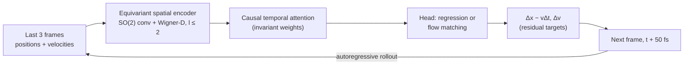

<p>
  <a href="https://antigravity.google/"></a>
  <sub>This project uses API credits from the Google Antigravity for Science program. Thank you, Google Antigravity!</sub>
</p>
<br clear="left">

<div align="center">
<picture>
  <source media="(prefers-color-scheme: dark)" srcset="assets/WignerFlow_mark_dark.svg">
  
</picture>

# WignerFlow

**Molecular dynamics without an integrator: an equivariant model that jumps a trajectory 50 fs per step.**

**Project Website & Interactive 3D Studio:** [https://yaniguan.github.io/WignerFlow/](https://yaniguan.github.io/WignerFlow/)

[](https://yaniguan.github.io/WignerFlow/)
[](LICENSE)
[](pyproject.toml)
[](https://github.com/yaniguan/WignerFlow/actions/workflows/tests.yml)
[](https://github.com/yaniguan/WignerFlow/discussions/categories/q-a)

</div>

## What it does

WignerFlow generates molecular dynamics trajectories directly. Given the last 3 frames (positions and velocities), an E(3)-equivariant network predicts the frame 50 fs later, so a rollout needs no force field and no numerical integrator. v0 shows the full pipeline on Lennard-Jones argon and tests whether a learned model stays physical for 10⁴ autoregressive steps.

## Quickstart

```bash
git clone https://github.com/yaniguan/WignerFlow.git && cd WignerFlow
pip install -e .                                   # torch, e3nn, numpy, scipy, h5py, matplotlib
# argon_flow_v0.pt is tracked in checkpoints/ (and also attached to the v0.1.0 GitHub release)
(cd checkpoints && sha256sum -c argon_flow_v0.pt.sha256)

python scripts/demo.py --ckpt checkpoints/argon_flow_v0.pt --steps 20 --out demo_out
```

No OpenMM and no data files needed. The demo rolls out 256 argon atoms from the bundled starting frames and writes `demo_out/summary.json` plus RDF, VACF and temperature plots against the ground truth. 20 steps (1 ps) take about 20 s on a laptop CPU; drop `--steps` for the default (200 on CPU, 1000 on GPU).

### PocketMD: Fast CPU Triage Calculator

Need a quick CPU pre-screen ("Should I send this docked pose or electrolyte additive to expensive production MD?")? Run [`scripts/pocket_md.py`](scripts/pocket_md.py) (full guide in [`docs/POCKET_MD.md`](docs/POCKET_MD.md)):

```bash
python scripts/pocket_md.py batch                  # screen drug poses + LiPF6 electrolyte additives + checkpoint
python scripts/pocket_md.py serve --port 8765      # launch local zero-dependency browser calculator UI
```

## Key features

- **No integrator.** The model alone advances the system, 50 fs per step (25× the 2 fs MD step).
- **E(3)-equivariant by construction.** eSCN-style SO(2) convolutions with Wigner-D edge alignment (l_max = 2) and invariant-only temporal attention.
- **Residual targets.** Predicts the change relative to coasting at constant velocity, which stops the system from cooling every step.
- **Two heads.** Deterministic regression or equivariant conditional flow matching.
- **Anti-drift training.** Teacher forcing, input noise and unrolled training with a curriculum.
- **Honest evaluation.** Model-only 10⁴-step rollouts, scored on crashes (NaN, steric overlap, and symmetric temperature bounds `T_ref / 3 <= T <= 3 T_ref`), temperature, reference-Hamiltonian total-energy drift (`H = U_ref + K`), position-velocity kinematic consistency, RDF, VACF and diffusion, with every seed reported.

## Results

Argon, 256 atoms, flow head, 15 rollouts × 10⁴ steps (0.5 ns each) per seed, model only, no thermostat (plus a 3 × 1000-step CPU audit for reference-force-field energy drift).

| Result | Value | Source |
|---|---|---|
| Seeds stable for 10⁴ steps (no crash, `T_ref / 3 <= T <= 3 T_ref`) | **4 of 5** (`min T_end = 79.6 K > 31.6 K`) | [`docs/release_v0.md`](docs/release_v0.md) ("How robust is this?"), [`results/argon/B_S3a_seeds.md`](results/argon/B_S3a_seeds.md) |
| Seeds meeting every v0 criterion | **2 of 5** | same |
| Released checkpoint: temperature vs truth (15 × 10⁴ GPU / 3 × 10³ CPU) | −6.0% / −2.9% | [`docs/release_v0.md`](docs/release_v0.md), [`RESULTS.md`](RESULTS.md) |
| Released checkpoint: total-energy drift `H = U_ref + K` (3 × 10³ CPU) | **−0.442 kJ/mol/ns/dof** (`ΔU = −0.026`, `ΔK = −0.034` kJ/mol/atom; NVE truth `−6.58e−5`; 15 × 10⁴ GPU pending) | [`RESULTS.md`](RESULTS.md), [`results/argon/B_S3a_seed1/eval_step10000_cpu_3x1000/metrics.json`](results/argon/B_S3a_seed1/eval_step10000_cpu_3x1000/metrics.json) |
| Rollout speed, one A100, batch 1 | **25.8 ns/day** (5.97 steps/s) | [`results/profiling/a100_oct29/profile.log`](results/profiling/a100_oct29/profile.log), made by [`scripts/profile_run.py`](scripts/profile_run.py) |

v0 criteria: no crash (`T_ref / 3 <= T <= 3 T_ref`, no NaN, no overlap); temperature within 5%; RDF peak position within 0.05 Å and height within 10%; VACF first zero within 10%; diffusion within 20%. Full tables (including reference-force-field energy drift and position-velocity kinematic consistency): [`RESULTS.md`](RESULTS.md).

Note: `checkpoints/argon_flow_v0.pt` was trained under tag `v0.1.0` (`attention_version="v0"`). On `main`, `EquiTraj` and all release loaders (`scripts/demo.py`, `equitraj/api.py`, `lab/surrogate_query.py`, `scripts/evaluate.py`, and `equitraj/pocket.py`) automatically run `v0` checkpoints with their exact training-time `v0` attention (no tag checkout needed), while `v1` checkpoints use the cutoff-continuous `v1` attention (`log(envelope)` inside `segment_softmax` with a zero-logit sink).

## How it works



External trajectory import, metadata, preflight checks, constraints, validation and pair exclusions: [`docs/md_tools.md`](docs/md_tools.md).

## Repo layout

```
equitraj/     model, layers, Wigner-D (so3.py), training, rollout, analysis
scripts/      demo, data generation, evaluation, profiling, checkpoint tools
configs/      one YAML per experiment
tests/        pytest suite (equivariance, permutation, PBC, neighbors, ...)
results/      metrics.json and figures per experiment
docs/         release notes, stability, speed, related work
colab/        GPU notebooks (full retrain, stable fine-tune, long rollout)
checkpoints/  small .pt weights (~8 MB) and SHA-256 checksums
```

## Limitations / status

- **v0, argon only.** Li⁺/EC, alanine dipeptide, the stride sweep and the baselines come later ([PLAN.md](PLAN.md)).
- **Checkpoint choice matters.** Temperature can swing by tens of percent between checkpoints 2000 steps apart; one seed crashes at ~4000 steps.
- **Not faster than classical MD yet.** OpenMM runs argon faster on a CPU. The payoff would come from replacing ab initio MD.
- Under periodic boundaries the box breaks global rotation symmetry; equivariance is local only. The model has no Hamiltonian and therefore exhibits measurable total-energy drift under the reference force field (`−0.442 kJ/mol/ns/dof` in 3 × 1000-step CPU rollouts vs `−6.58e−5` for OpenMM NVE; full 15 × 10⁴ GPU energy audit pending).
- The full-data stable fine-tune ([docs/ARGON_STABLE_FT.md](docs/ARGON_STABLE_FT.md)) has no final evaluation yet.

Training, data generation and evaluation commands: [docs/release_v0.md](docs/release_v0.md), [RESULTS.md](RESULTS.md) and `scripts/`.

## Citation

```bibtex
@misc{wignerflow2026,
  title  = {WignerFlow: Autoregressive E(3)-Equivariant Generation of Molecular Dynamics Trajectories},
  author = {Guan, Yani},
  year   = {2026},
  url    = {https://github.com/yaniguan/WignerFlow},
  note   = {v0.1.0, work in progress}
}
```

Related work (TrajCast, FlashMD, Timewarp, MDGen): [docs/related_work.md](docs/related_work.md).

## License

Apache-2.0. See [LICENSE](LICENSE).
