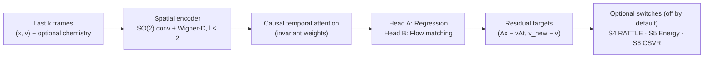

<p>
  <a href="https://antigravity.google/"></a>
  <sub>This project uses API credits from the Google Antigravity for Science program. Thank you, Google Antigravity!</sub>
</p>
<br clear="left">

<div align="center">
<picture>
  <source media="(prefers-color-scheme: dark)" srcset="assets/WignerFlow_mark_dark.svg">
  
</picture>

# WignerFlow

**Autoregressive O(3)-equivariant molecular dynamics without a numerical integrator.**

[](LICENSE)
[](pyproject.toml)
[](https://github.com/yaniguan/WignerFlow/actions/workflows/tests.yml)

</div>

## Overview

`WignerFlow` (`import wignerflow` / `import equitraj`) generates molecular dynamics trajectories directly in phase space $(\mathbf{x}, \mathbf{v})$. Given the last $k$ frames, an edge-aligned $SO(2)$ Wigner-$D$ network (`l_max = 2`) with invariant causal temporal attention and residual conditional flow matching advances the trajectory by a coarse time stride (e.g. `20–50 fs`, `10–25x` the MD integration step) without force evaluations or a numerical integrator.

This branch retains **only the lean core research stack**—models, controlled baselines (`PlainTraj`, `TrajCastBaseline`, `EquiFF`), optional inference switches (`S4` RATTLE constraints, `S5` FlashMD-style energy rescaling, `S6` CSVR thermostat), progressive flow distillation, and physical evaluation.

## Quickstart

```bash
git clone -b core/lean-wignerflow https://github.com/yaniguan/WignerFlow.git
cd WignerFlow
pip install -e .                                   # torch, e3nn, numpy, scipy, h5py, matplotlib, PyYAML
(cd checkpoints && sha256sum -c argon_flow_v0.pt.sha256)

# Standalone rollout from bundled 3-frame context (no OpenMM or external HDF5 needed)
wignerflow demo --ckpt checkpoints/argon_flow_v0.pt --steps 20 --out demo_out
```

## Core Architecture & Controlled Baselines



All models share the same dataset loader, target scaling (`element_std` or `mass`), training curriculum, and evaluation scripts:

| Architecture (`model.arch`) | Symmetry & Layer | Conditioning | Default Head | Role |
| :--- | :--- | :--- | :--- | :--- |
| `equi` (`EquiTraj`) | $O(3)$ eSCN $SO(2)$ conv + Wigner-$D$ | $k$-frame temporal attention | Conditional flow matching | Main WignerFlow model |
| `trajcast` (`TrajCastBaseline`) | $O(3)$ `e3nn` Clebsch–Gordan `TensorProduct` | Markovian $1$-frame (`k=1`) | Deterministic regression | Closest-prior-work baseline (Thiemann et al., 2025) |
| `plain` (`PlainTraj`) | Translation + permutation only (Cartesian) | $k$-frame temporal attention | Flow or regression | Symmetry ablation |
| `EquiFF` + `verlet_rollout` | Conservative energy gradient $-\nabla_x E$ | $1$-frame | Velocity Verlet | Force-field + integrator baseline |

**Symmetry under periodic boundaries:** In free space—or when rotating atomic coordinates and lattice vectors together $(\mathbf{x}, \mathbf{B}) \mapsto (\mathbf{x}\mathbf{R}^\top, \mathbf{B}\mathbf{R}^\top)$—the network is exact $O(3)$-equivariant (`~1e-14` in FP64). Under a *fixed* cubic periodic box, minimum-image wrapping reduces global continuous rotational symmetry to the octahedral point group $O_h$.

## Measured v0 Results (256-Atom Liquid Argon, 50 fs Stride)

15 rollouts $\times 10^4$ steps (`0.5 ns` each) per seed, **model-only NVE** (`S4=S5=S6=off`):

| Metric | Value | Source |
| :--- | :--- | :--- |
| Seeds surviving $10^4$ steps without crash | **4 / 5** | [`RESULTS.md`](RESULTS.md), [`results/argon/B_S3a_seeds.md`](results/argon/B_S3a_seeds.md) |
| Seeds passing all v0 criteria (`|ΔT|/T < 5%`, RDF, VACF, $D$) | **2 / 5** (`seed3`: `-2.9%`, `seed4`: `-2.4%`) | [`RESULTS.md`](RESULTS.md) |
| Legacy `v0.1.0` checkpoint (`argon_flow_v0.pt`) `ΔT/T` | `-6.0%` (`+0.1%` with `S6` CSVR) | [`docs/release_v0.md`](docs/release_v0.md) |
| A100 rollout throughput (`B=1`, `S=10`, eager FP32) | **25.8 ns/day** (`5.97 steps/s`) | [`results/profiling/a100_oct29/profile.log`](results/profiling/a100_oct29/profile.log) |

> **Current status & H100 roadmap:** Publicly committed model rollouts in [`RESULTS.md`](RESULTS.md) cover liquid argon (`v0.1.0` checkpoint predating the `v1` cutoff-envelope sink update). Production H100 configs for `v1` Argon retraining, covalent molecules (`ala2`, `aspirin`, `md17_aspirin` CCSD), `1,008`-atom `Li+/EC/PF6-`, and head-to-head `TrajCastBaseline` runs—along with a bottom-up H100 GPU-hour budget—are in [`configs/`](configs/) and [`docs/H100_COMPUTE_PLAN.md`](docs/H100_COMPUTE_PLAN.md).

## Repository Layout

```text
equitraj/     Core library (so3, layers, neighbors, model, baselines, forcefield,
              constraints, thermostat, rollout, fast, distill, dataset, adapters,
              train, evaluation, multiseed, analysis, profiling)
wignerflow/   Public package alias (`import wignerflow`) and unified CLI
configs/      Experiment YAMLs (argon, ala2, aspirin, md17_aspirin, li_ec, nacl)
scripts/      Thin CLI entry points (demo, evaluate, evaluate_molecule, distill, export_ckpt, ...)
systems/      Committed OpenMM XML force fields and starting PDB structures
checkpoints/  Tracked small checkpoints (~8 MB) and SHA-256 checksums
results/      Ground-truth and rollout metrics.json + plots
docs/         Technical notes, related work, stability, speed, and H100 compute plan
tests/        Pytest suite (O(3) & O_h symmetry, PBC, baselines, switches S4-S6, BF16, ...)
```

## Common Commands

```bash
# 1. Train EquiTraj or TrajCastBaseline (supports train.amp=bf16 and model.gradient_checkpointing=true)
wignerflow train --config configs/ala2/h100_v1.yaml --device cuda
wignerflow train --config configs/ala2/trajcast_h100.yaml --device cuda

# 2. Evaluate periodic or vacuum-molecule checkpoints (model-only NVE, or with S4 / S6 switches)
wignerflow evaluate --run results/argon/h100_v1 --ckpt best_stable.pt --steps 10000
wignerflow evaluate-molecule --run results/ala2/h100_v1 --ckpt best_stable.pt --steps 10000
wignerflow evaluate-molecule --run results/ala2/h100_v1 --ckpt best_stable.pt --project_constraints

# 3. Distill 10-step flow head -> 4 -> 2 -> 1 steps
wignerflow distill --teacher four.pt --data train_contexts.pt --teacher-steps 4 --out two.pt
```

## Citation & License

```bibtex
@misc{wignerflow2026,
  title  = {WignerFlow: Autoregressive E(3)-Equivariant Generation of Molecular Dynamics Trajectories},
  author = {Guan, Yani},
  year   = {2026},
  url    = {https://github.com/yaniguan/WignerFlow}
}
```

Apache-2.0. See [LICENSE](LICENSE).
