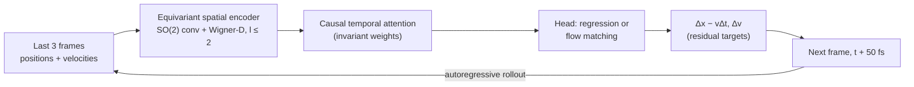

<p>
  <a href="https://antigravity.google/"></a>
  <sub>This project uses API credits from the Google Antigravity for Science program. Thank you, Google Antigravity!</sub>
</p>
<br clear="left">

<div align="center">
<picture>
  <source media="(prefers-color-scheme: dark)" srcset="assets/WignerFlow_mark_dark.svg">
  
</picture>

# WignerFlow

**Molecular dynamics without an integrator: an equivariant model that jumps a trajectory 50 fs per step.**

[](LICENSE)
[](pyproject.toml)
[](https://github.com/yaniguan/WignerFlow/actions/workflows/tests.yml)
[](https://github.com/yaniguan/WignerFlow/discussions/categories/q-a)

</div>

## What it does

WignerFlow generates molecular dynamics trajectories directly. Given the last 3 frames (positions and velocities), an E(3)-equivariant network predicts the frame 50 fs later, so a rollout needs no force field and no numerical integrator. v0 shows the full pipeline on Lennard-Jones argon and tests whether a learned model stays physical for 10⁴ autoregressive steps.

## Quickstart

```bash
git clone https://github.com/yaniguan/WignerFlow.git && cd WignerFlow
pip install -e .                                   # torch, e3nn, numpy, scipy, h5py, matplotlib
gh release download v0.1.0 -D checkpoints -p 'argon_flow_v0.pt'   # or download it from the v0.1.0 release page
(cd checkpoints && sha256sum -c argon_flow_v0.pt.sha256)

python scripts/demo.py --ckpt checkpoints/argon_flow_v0.pt --steps 20 --out demo_out
```

No OpenMM and no data files needed. The demo rolls out 256 argon atoms from the bundled starting frames and writes `demo_out/summary.json` plus RDF, VACF and temperature plots against the ground truth. 20 steps (1 ps) take about 20 s on a laptop CPU; drop `--steps` for the default (200 on CPU, 1000 on GPU).

### PocketMD: Fast CPU Triage Calculator

Need a 1-second CPU pre-screen ("Should I send this docked pose or electrolyte additive to 50-GPU-hour Big MD?")? Run [`scripts/pocket_md.py`](scripts/pocket_md.py) (full guide in [`docs/POCKET_MD.md`](docs/POCKET_MD.md)):

```bash
python scripts/pocket_md.py batch                  # screen drug poses + LiPF6 electrolyte additives + checkpoint
python scripts/pocket_md.py serve --port 8765      # launch local zero-dependency browser calculator UI
```

## Key features

- **No integrator.** The model alone advances the system, 50 fs per step (25× the 2 fs MD step).
- **E(3)-equivariant by construction.** eSCN-style SO(2) convolutions with Wigner-D edge alignment (l_max = 2) and invariant-only temporal attention.
- **Residual targets.** Predicts the change relative to coasting at constant velocity, which stops the system from cooling every step.
- **Two heads.** Deterministic regression or equivariant conditional flow matching.
- **Anti-drift training.** Teacher forcing, input noise and unrolled training with a curriculum.
- **Honest evaluation.** Model-only 10⁴-step rollouts, scored on crashes, temperature, RDF, VACF and diffusion, with every seed reported.

## Results

Argon, 256 atoms, flow head, 15 rollouts × 10⁴ steps (0.5 ns each) per seed, model only, no thermostat.

| Result | Value | Source |
|---|---|---|
| Seeds stable for 10⁴ steps (no crash) | **4 of 5** | [`docs/release_v0.md`](docs/release_v0.md) ("How robust is this?"), [`results/argon/B_S3a_seeds.md`](results/argon/B_S3a_seeds.md) |
| Seeds meeting every v0 criterion | **2 of 5** | same |
| Released checkpoint: temperature vs truth | −6.0% | [`docs/release_v0.md`](docs/release_v0.md) |
| Rollout speed, one A100, batch 1 | **25.8 ns/day** (5.97 steps/s) | [`results/profiling/a100_oct29/profile.log`](results/profiling/a100_oct29/profile.log), made by [`scripts/profile_run.py`](scripts/profile_run.py) |

v0 criteria: no crash; temperature within 5%; RDF peak position within 0.05 Å and height within 10%; VACF first zero within 10%; diffusion within 20%. Full tables: [`RESULTS.md`](RESULTS.md).

## How it works



## Repo layout

```
equitraj/     model, layers, Wigner-D (so3.py), training, rollout, analysis
scripts/      demo, data generation, evaluation, profiling, checkpoint tools
configs/      one YAML per experiment
tests/        pytest suite (equivariance, permutation, PBC, neighbors, ...)
results/      metrics.json and figures per experiment
docs/         release notes, stability, speed, related work
colab/        GPU notebooks (full retrain, stable fine-tune, long rollout)
checkpoints/  checksums; weights are on the GitHub release
```

## Limitations / status

- **v0, argon only.** Li⁺/EC, alanine dipeptide, the stride sweep and the baselines come later ([PLAN.md](PLAN.md)).
- **Checkpoint choice matters.** Temperature can swing by tens of percent between checkpoints 2000 steps apart; one seed crashes at ~4000 steps.
- **Not faster than classical MD yet.** OpenMM runs argon faster on a CPU. The payoff would come from replacing ab initio MD.
- Under periodic boundaries the box breaks global rotation symmetry; equivariance is local only. The model has no Hamiltonian.
- The full-data stable fine-tune ([docs/ARGON_STABLE_FT.md](docs/ARGON_STABLE_FT.md)) has no final evaluation yet.

Training, data generation and evaluation commands: [docs/release_v0.md](docs/release_v0.md), [RESULTS.md](RESULTS.md) and `scripts/`.

## Citation

```bibtex
@misc{wignerflow2026,
  title  = {WignerFlow: Autoregressive E(3)-Equivariant Generation of Molecular Dynamics Trajectories},
  author = {Guan, Yani},
  year   = {2026},
  url    = {https://github.com/yaniguan/WignerFlow},
  note   = {v0.1.0, work in progress}
}
```

Related work (TrajCast, FlashMD, Timewarp, MDGen): [docs/related_work.md](docs/related_work.md).

## License

Apache-2.0. See [LICENSE](LICENSE).

To include PFF metadata, pass it to `import_trajectory(particle_metadata=...)`
or use a JSON file with `scripts/import_md.py --particle-metadata FILE`.
Metadata is off by default. The version 1 format in `equitraj/topology.py`
requires `version: 1`,
`units: {"charge": "e", "distance": "nm"}`, per-particle `charges`,
`ff_types`, `molecule_ids`, and unique `original_indices`, plus `bonds`
(index pairs), `constraints` (index, index, distance), and
`drude_parent_map` (Drude, parent pairs). Empty topology lists are valid.
Filtering updates particle indices and keeps `original_indices` unchanged.
It drops bonds and constraints that include removed particles. It raises an
error if a kept Drude's parent was removed. Charges and masses are never
combined. `read_traj` checks the metadata and returns it as `particle_metadata`.
Files without metadata still work.

Before using caches, training checks the HDF5 files in all configured splits.
It checks atom order and elements, masses, time steps, periodicity, positions,
velocities, and fixed cells. Each trajectory can have a different fixed cell.
Optional `atom_ids` or `particle_names` datasets let it check the order of atoms
with the same element. Without these, it cannot detect changes in their order.
To reject estimated velocities, set `reject_estimated_velocities: true` in the
training config or pass the same keyword to `TrajWindows`. It defaults to `false`.

Distance constraints are off by default. To enable them, pass
`constraint_projector=DistanceProjector([(i, j, distance_A), ...])` to
`equitraj.rollout.rollout`. Import `DistanceProjector` from `equitraj.constraints`.
Corrections use particle masses and keep the center of mass and total momentum
fixed. Masses must be positive, and constraints must be independent.
Corrections run after the optional thermostat. Temperature calculations account
for the constraints. Diagnostics record the remaining errors and correction
sizes. The rollout raises an error if corrections fail to reach the tolerances.
Periodic distances use the nearest image. Corrections can change kinetic energy
and transport, so check the results for your physical system.

`equitraj.validation.validate` accepts `charges` as one value per atom, in
units of the elementary charge, or as a dictionary of charges by element.
Pass integer `molecule_ids` to report each molecule's center of mass diffusion
and use its net charge for Nernst–Einstein conductivity. The center of mass
is weighted by atom mass. Molecular analysis is off by default.
Einstein–Helfand conductivity always uses the combined motion of atom charges.
Keep each molecule whole and use unwrapped coordinates in a common rest frame.
Motion of charges within a molecule can affect Einstein–Helfand estimates over
the measured time lags, even if those charges stay close together.
These estimates alone do not show that the trajectories are long enough.

Pair exclusions are off by default. To exclude pairs, use a boolean `(N,N)`
mask with `True` for each excluded pair. The mask must be symmetric and use
the current particle order. Pass `excluded_pairs=mask` to `RepulsionPrior`,
`overlap_penalty`, `estimate_rmin`, and `rollout` (or `StabilityMonitor`).
These skip the excluded pairs when pushing atoms apart, damping velocities,
computing the overlap loss, estimating distance limits, and checking or
reporting overlaps. Pairs in the same molecule are not excluded automatically.
The prior's mask is not saved in checkpoints. Supply it again when loading
a model, using the same particle order. Other crash checks still apply.
