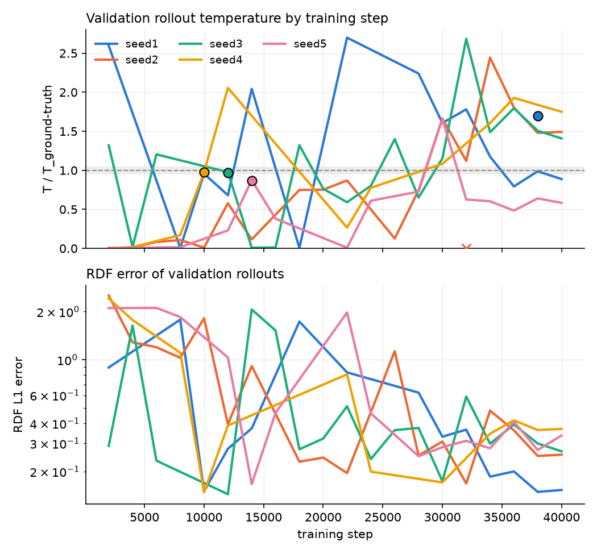

# Results

Generated by `python scripts/make_results.py` from the `metrics.json` files under `results/`.
Rollouts replace the integrator completely (no OpenMM). "Model only" means no thermostat and no energy rescaling.

## Ground truth (OpenMM, NVE)

| System | Trajectories | T (K) | Energy drift (kJ/mol/ns/dof) | First RDF peak | D (cm²/s) | OpenMM speed (ns/day) |
|---|---|---|---|---|---|---|
| ala2 | 10 | 304.0 | 0.000112 (max 0.000361) | C-C: 1.55 Å, 1.78 | – | 198 (CPU) |
| argon | 10 | 94.9 | -6.58e-05 (max 0.000137) | Ar-Ar: 3.69 Å, 2.86 | 2.22e-05 | 515 (CPU) |
| aspirin | 10 | 308.6 | -7.43e-05 (max 0.00154) | C-C: 1.42 Å, 2.15 | – | 237 (CPU) |

## Model rollouts

Errors are relative unless marked Å; the temperature column shows the signed error. v0 criteria (argon): no crash; |ΔT|/T < 5%; RDF peak position < 0.05 Å; peak height < 10%; VACF first zero < 10%; D < 20%.

| Run | Head | Target | Seed | Stride (fs) | Rollouts × steps | Not crashed | T model / truth (K) | RDF peak pos (Å) | RDF peak height | VACF zero | D | v0 |
|---|---|---|---|---|---|---|---|---|---|---|---|---|
| argon/A_S3a_direct, step 6000 | regression | direct | 0 | 50 | 3 × 10000 | 3/3 | 37.2 / 94.9 (-60.8%) | 0.126 | 0.627 | 0.0849 | 0.923 | **fail** |
| argon/A_S3a_seed1, step 40000 | regression | residual | 1 | 50 | 3 × 10000 | 3/3 | 57.8 / 94.9 (-39.1%) | 0.0774 | 0.133 | 0.0449 | 0.383 | **fail** |
| argon/A_S3a_seed2, step 40000 | regression | residual | 2 | 50 | 3 × 10000 | 3/3 | 50.9 / 94.9 (-46.4%) | 0.0839 | 0.162 | 0.0647 | 0.472 | **fail** |
| argon/B_S3a_direct, step 8000 | flow | direct | 0 | 50 | 15 × 10000 | 15/15 | 163.8 / 94.9 (+72.5%) | 0.0442 | 0.127 | 0.0535 | 0.881 | **fail** |
| argon/B_S3a_h400, step 40000 | flow | residual | 0 | 50 | 15 × 10000 | 15/15 | 107.4 / 94.9 (+13.2%) | 0.00268 | 0.0378 | 0.024 | 0.153 | **fail** |
| argon/B_S3a_seed1, step 38000 | flow | residual | 1 | 50 | 15 × 10000 | 15/15 | 160.9 / 94.9 (+69.6%) | 0.0445 | 0.122 | 0.0361 | 0.598 | **fail** |
| argon/B_S3a_seed1 (eval_csvr500), step 38000 | flow | residual | 1 | 50 | 15 × 10000 | 15/15 | 95.1 / 94.9 (+0.2%) | 0.0136 | 0.00974 | 0.0106 | 0.0188 | pass |
| argon/B_S3a_seed1 (eval_step10000), step 10000 | flow | residual | 1 | 50 | 15 × 10000 | 15/15 | 89.2 / 94.9 (-6.0%) | 0.0246 | 0.000985 | 0.00621 | 0.113 | **fail** |
| argon/B_S3a_seed1 (eval_step10000_csvr500), step 10000 | flow | residual | 1 | 50 | 15 × 10000 | 15/15 | 94.8 / 94.9 (-0.1%) | 0.0216 | 0.00853 | 0.012 | 0.0283 | pass |
| argon/B_S3a_seed2, step 32000 | flow | residual | 2 | 50 | 15 × 10000 | 0/15 | – / 94.9 (–) | – | – | – | – | – |
| argon/B_S3a_seed3, step 12000 | flow | residual | 3 | 50 | 15 × 10000 | 15/15 | 92.2 / 94.9 (-2.9%) | 0.016 | 0.00671 | 0.0163 | 0.0644 | pass |
| argon/B_S3a_seed4, step 10000 | flow | residual | 4 | 50 | 15 × 10000 | 15/15 | 92.6 / 94.9 (-2.4%) | 0.019 | 0.00288 | 0.00313 | 0.0256 | pass |
| argon/B_S3a_seed5, step 14000 | flow | residual | 5 | 50 | 15 × 10000 | 15/15 | 82.3 / 94.9 (-13.3%) | 0.0267 | 0.026 | 0.0303 | 0.155 | **fail** |

## Stability by training step

Each line is one training seed (flow head, residual targets, default `best.pt` selection). Rollouts are 1000 steps on validation trajectories, evaluated every 2000 training steps; the grey band is ±5% of the ground-truth temperature. Dots are the checkpoints that were tested with 10⁴-step rollouts (dot height = test temperature / truth); an x marks a checkpoint whose 10⁴-step test rollouts all crashed.
