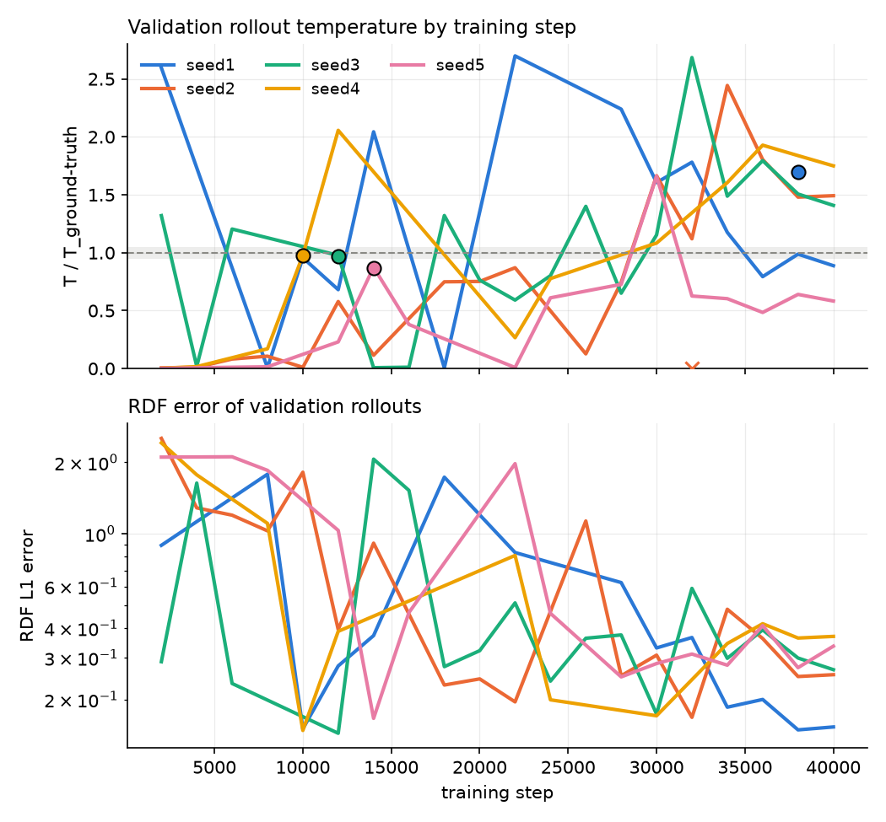

# Results

Generated by `python scripts/make_results.py` from the `metrics.json` files under `results/`.
Rollouts replace the integrator completely (no OpenMM). "Model only" means no thermostat and no energy rescaling.

## Ground truth (OpenMM, NVE)

| System | Trajectories | T (K) | Energy drift (kJ/mol/ns/dof) | First RDF peak | D (cm²/s) | OpenMM speed (ns/day) |
|---|---|---|---|---|---|---|
| ala2 | 10 | 304.0 | 0.000112 (max 0.000361) | C-C: 1.55 Å, 1.78 | – | 198 (CPU) |
| argon | 10 | 94.9 | -6.58e-05 (max 0.000137) | Ar-Ar: 3.69 Å, 2.86 | 2.22e-05 | 515 (CPU) |
| aspirin | 10 | 308.6 | -7.43e-05 (max 0.00154) | C-C: 1.42 Å, 2.15 | – | 237 (CPU) |

## Model rollouts

Errors are relative unless marked Å; the temperature column shows the signed error. `H drift` reports total-energy drift (`U_ref + K`, in `kJ/mol/ns/dof`) evaluated under the reference Lennard-Jones force field next to the OpenMM NVE ground-truth drift, and `ΔU/atom`, `ΔK/atom` (in `kJ/mol`) report second-half potential and kinetic energy offsets per atom relative to ground truth (`not measured` for earlier runs evaluated before the `energy` block was recorded; short CPU evaluations are labeled `(CPU)` and are distinct from the full `15 × 10000` GPU protocol). v0 criteria (argon): no crash (`T_ref / 3 <= T <= 3 T_ref`, no NaN, no overlap); |ΔT|/T < 5%; RDF peak position < 0.05 Å; peak height < 10%; VACF first zero < 10%; D < 20%.

| Run | Head | Target | Seed | Stride (fs) | Rollouts × steps | Not crashed | T model / truth (K) | H drift (kJ/mol/ns/dof) | ΔU/atom (kJ/mol) | ΔK/atom (kJ/mol) | RDF peak pos (Å) | RDF peak height | VACF zero | D | v0 |
|---|---|---|---|---|---|---|---|---|---|---|---|---|---|---|---|
| argon/A_S3a_direct, step 6000 | regression | direct | 0 | 50 | 3 × 10000 | 3/3 | 37.2 / 94.9 (-60.8%) | not measured | not measured | not measured | 0.126 | 0.627 | 0.0849 | 0.923 | **fail** |
| argon/A_S3a_seed1, step 40000 | regression | residual | 1 | 50 | 3 × 10000 | 3/3 | 57.8 / 94.9 (-39.1%) | not measured | not measured | not measured | 0.0774 | 0.133 | 0.0449 | 0.383 | **fail** |
| argon/A_S3a_seed2, step 40000 | regression | residual | 2 | 50 | 3 × 10000 | 3/3 | 50.9 / 94.9 (-46.4%) | not measured | not measured | not measured | 0.0839 | 0.162 | 0.0647 | 0.472 | **fail** |
| argon/B_S3a_direct, step 8000 | flow | direct | 0 | 50 | 15 × 10000 | 15/15 | 163.8 / 94.9 (+72.5%) | not measured | not measured | not measured | 0.0442 | 0.127 | 0.0535 | 0.881 | **fail** |
| argon/B_S3a_h400, step 40000 | flow | residual | 0 | 50 | 15 × 10000 | 15/15 | 107.4 / 94.9 (+13.2%) | not measured | not measured | not measured | 0.00268 | 0.0378 | 0.024 | 0.153 | **fail** |
| argon/B_S3a_seed1, step 38000 | flow | residual | 1 | 50 | 15 × 10000 | 15/15 | 160.9 / 94.9 (+69.6%) | not measured | not measured | not measured | 0.0445 | 0.122 | 0.0361 | 0.598 | **fail** |
| argon/B_S3a_seed1 (eval_csvr500), step 38000 | flow | residual | 1 | 50 | 15 × 10000 | 15/15 | 95.1 / 94.9 (+0.2%) | not measured | not measured | not measured | 0.0136 | 0.00974 | 0.0106 | 0.0188 | pass |
| argon/B_S3a_seed1 (eval_step10000), step 10000 | flow | residual | 1 | 50 | 15 × 10000 | 15/15 | 89.2 / 94.9 (-6.0%) | not measured | not measured | not measured | 0.0246 | 0.000985 | 0.00621 | 0.113 | **fail** |
| argon/B_S3a_seed1 (eval_step10000_cpu_3x1000), step 10000 | flow | residual | 1 | 50 | 3 × 1000 (CPU) | 3/3 | 91.3 / 94.0 (-2.9%) | -0.442 (gt -6.58e-05) | -0.026 | -0.0336 | 0.013 | 0.0119 | 0.0126 | 0.0415 | pass |
| argon/B_S3a_seed1 (eval_step10000_csvr500), step 10000 | flow | residual | 1 | 50 | 15 × 10000 | 15/15 | 94.8 / 94.9 (-0.1%) | not measured | not measured | not measured | 0.0216 | 0.00853 | 0.012 | 0.0283 | pass |
| argon/B_S3a_seed2, step 32000 | flow | residual | 2 | 50 | 15 × 10000 | 0/15 | – / 94.9 (–) | not measured | not measured | not measured | – | – | – | – | – |
| argon/B_S3a_seed3, step 12000 | flow | residual | 3 | 50 | 15 × 10000 | 15/15 | 92.2 / 94.9 (-2.9%) | not measured | not measured | not measured | 0.016 | 0.00671 | 0.0163 | 0.0644 | pass |
| argon/B_S3a_seed4, step 10000 | flow | residual | 4 | 50 | 15 × 10000 | 15/15 | 92.6 / 94.9 (-2.4%) | not measured | not measured | not measured | 0.019 | 0.00288 | 0.00313 | 0.0256 | pass |
| argon/B_S3a_seed5, step 14000 | flow | residual | 5 | 50 | 15 × 10000 | 15/15 | 82.3 / 94.9 (-13.3%) | not measured | not measured | not measured | 0.0267 | 0.026 | 0.0303 | 0.155 | **fail** |

## Reading the `kinematics` and `energy` diagnostics (`metrics.json`)

- **Position-velocity consistency (`kinematics` block, report-only):** `scripts/evaluate.py` computes three checks identically on surviving model rollouts and on ground-truth trajectories subsampled at the same 50 fs stride:
  1. `trapezoid_residual` = `RMS(Δx - 0.5 * (v_t + v_{t+1}) * Δt) / RMS(Δx)`. At a 50 fs stride in liquid argon, atomic accelerations curve the trajectory between saved frames, so ground truth has a nonzero baseline (~0.021); a substantially larger model value indicates decoupled `Δx` and `v_new` heads.
  2. `displacement_temperature_K` (from chord velocities `Δx / Δt`) vs `velocity_temperature_K` (from predicted `v`) and `temperature_rel_gap = (T_vel - T_disp) / T_disp`. At 50 fs, chord averaging slightly filters high-frequency motion in ground truth (`temperature_rel_gap` ~ +1.1%); a large excess gap shows velocity statistics and spatial step sizes disagree.
  3. `green_kubo_D_cm2_s` (trapezoidal time integral `(1/3) ∫ <v(0)·v(t)> dt` over the VACF window) vs `einstein_D_cm2_s` (linear MSD slope `slope / 6`), testing whether velocity-space memory and position-space transport give consistent diffusivity.
- **Reference-Hamiltonian energy (`energy` block):** Direct 50 fs predictors do not integrate a conservative Hamiltonian; `H_drift_kJ_mol_ns_dof_mean` measures linear drift of `H = U_ref(x) + K(v)` per ns per degree of freedom on surviving rollouts, while `U_model_minus_gt_per_atom` and `K_model_minus_gt_per_atom` show whether steady-state energy errors arise from steric configurational offset (`ΔU`) or thermal offset (`ΔK`). Note: seed 3 and seed 4 `best.pt` weights are not tracked in git, so their `15 × 10000` energy drift rows remain `not measured` pending GPU re-evaluation.

## Stability by training step

Each line is one training seed (flow head, residual targets, default `best.pt` selection). Rollouts are 1000 steps on validation trajectories, evaluated every 2000 training steps; the grey band is ±5% of the ground-truth temperature. Dots are the checkpoints that were tested with 10⁴-step rollouts (dot height = test temperature / truth); an x marks a checkpoint whose 10⁴-step test rollouts all crashed.
